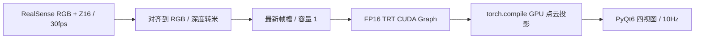

# LingBot-Depth RealSense GUI

用 **RealSense + LingBot-Depth-v0.5 + TensorRT + GPU 点云投影** 实时增强深度，通过 PyQt6 同时显示 RGB、原始深度、增强深度和可交互的彩色 3D 点云。

相机采集 640×480、30fps，转换和显示以 **10Hz** 调度。采集与推理分别运行在后台线程，只保留最新帧；四个视图始终来自同一帧。



## 启动与设备查询

下文所有项目文件路径均相对仓库根目录；克隆后先进入 `lingbot-depth-realsense/`。已有环境与引擎时直接运行：

```bash
./run_gui.sh
```

单相机自动选择。设备型号、序列号、深度比例和内参均在运行时从 SDK 读取，不固定到某台设备。窗口打开后会自动开始采集，首次启动需要完成引擎加载和 GPU 预热。

通过 RealSense SDK 查询当前连接设备的型号与序列号：

```bash
env -u PYTHONPATH .venv-optimization/bin/python - <<'PY'
import pyrealsense2 as rs
context = rs.context()
for device in context.query_devices():
    print(device.get_info(rs.camera_info.name), device.get_info(rs.camera_info.serial_number))
PY
```

多相机时，将查询结果中目标设备的序列号保存到 shell 变量 `realsense_serial`，再使用 `./run_gui.sh --serial "$realsense_serial"`。查询不会开启视频流。

## 安装

已验证环境：Ubuntu 24.04、Python 3.12、RTX 5060 Ti 16GB、驱动 595.91.07、torch 2.8.0+cu128、TensorRT 10.12.0.36、pyrealsense2 2.59.1.11053、PyQt6 6.11.0 / Qt 6.11.2。

```bash
git clone git@github.com:terryma2024/lingbot-depth-realsense.git
cd lingbot-depth-realsense

sudo apt-get install libxcb-cursor0
uv venv --python 3.12 .venv-optimization

uv pip install --python .venv-optimization/bin/python \
  --index https://download.pytorch.org/whl/cu128 \
  torch==2.8.0+cu128 torchvision==0.23.0+cu128 xformers==0.0.32.post2

uv pip install --python .venv-optimization/bin/python -e '.[build,test]'
```

若已经有匹配的 TensorRT 引擎，只需要应用依赖：`uv pip install --python .venv-optimization/bin/python -e .`。先安装上面的 CUDA 版 torch，避免得到不匹配的 GPU 运行环境。

如需项目内默认使用清华镜像，可在仓库根目录创建 `uv.toml` 并写入以下配置；已配置用户级默认源时可跳过：

```toml
[[index]]
name = "tuna"
url = "https://pypi.tuna.tsinghua.edu.cn/simple"
default = true
```

CUDA wheel 仍通过上面的显式 PyTorch 索引安装。启动脚本清除 ROS 的 `PYTHONPATH`，应用选择 PyQt6 自带插件，避免与 OpenCV 的 Qt 插件冲突。

## 下载权重并构建引擎

权重和引擎不随 Git 提交。引擎固定为 batch=1、640×480、FP16、目标 2000 tokens，应在目标 GPU 上构建。

```bash
.venv-optimization/bin/hf download \
  robbyant/lingbot-depth-pretrain-vitl-14-v0.5 model.pt \
  --revision 79204ed6b837f4fdd192cf563e59481fecfa0295 \
  --local-dir checkpoints/lingbot-depth-v0.5

git clone https://github.com/Ar-Ray-code/lingbot-depth-trt \
  result/optimization/reference-lingbot-depth-trt
git -C result/optimization/reference-lingbot-depth-trt checkout \
  60e69ab6ea5c65a2f19a22388a20d5969a8f556b

env -u PYTHONPATH .venv-optimization/bin/python \
  result/optimization/reference-lingbot-depth-trt/tools/export_trt.py \
  --model checkpoints/lingbot-depth-v0.5/model.pt \
  --capture examples/0 \
  --precision fp16 --num-tokens 2000 --width 640 --height 480 \
  --work-dir result/optimization/reference-trt-nt2000-fp16 \
  --skip-ort --workspace-gb 4 --tactic-gb 2 \
  --trt-warmup 10 --trt-runs 100
```

checkpoint SHA256：`b60cf27ddbd0e51e9b59b03475c0d39d02d2e48ecf8dbb5866f04d46802b3c23`。

默认读取 `result/optimization/reference-trt-nt2000-fp16/lingbot_depth_nt2000.engine`。也可指定已有引擎：

```bash
./run_gui.sh --engine result/optimization/reference-trt-nt2000-fp16/lingbot_depth_nt2000.engine
```

## 使用

- 四视图为 RGB、对齐后的原始深度、TRT 增强深度和彩色 3D 点云。
- 点击“停止”释放相机和推理工作线程；点击“开始”重新运行。
- 在点云中拖动旋转、滚轮缩放；“重置 3D 视角”恢复初始视点。
- 显示距离默认 0.1–5m；点云步长默认 2，最多显示 76800 个点。GPU 始终投影完整 307200 个像素。
- 两个深度视图共用米制色标，无效深度显示黑色。原始数据保持相机坐标 X右、Y下、Z前；3D 显示使用 X右、Y前、Z上。
- 状态栏显示最近 2 秒的新结果 Hz、转换时间、GPU 时间、应用延迟和显示点数；重复旧帧不会计入刷新率。

## 实测

2026-10-13，D435i + RTX 5060 Ti，预热后连续 60 秒，640×480、batch=1、FP16、点云步长 2：

| 指标 | 结果 |
|---|---:|
| 新结果显示率 | **9.98Hz** |
| 显示间隔 P95 | 102.99ms |
| 完整转换平均 / P95 | 73.16 / 78.36ms |
| TRT＋GPU 投影平均 / P95 | 67.94 / 72.52ms |
| 应用延迟平均 / P95 | 111.97 / 125.30ms |
| GUI 进程总显存峰值 | **1231MiB，约 1.20GiB** |
| 稳定期新结果 | 600 帧 |
| 点云 Z 与增强深度 | 逐帧一致 |
| 线程及相机清理 | 通过 |

完整转换时间包括 CPU 预处理、输入复制、TRT、投影和结果拷回。应用延迟从主机 SDK 收帧计到 Qt 更新提交，不含曝光、USB 传输或显示器扫描。显存为 `nvidia-smi` 对本进程每秒采样的总量，包含原生 TRT 分配；不能用 torch allocator 数值代替。

本次验收检查了输入及预测随帧变化、米制几何、刷新率和退出；不是对预测精度的 ground-truth 评估。更多开发与诊断记录见 [docs/DEVELOPMENT_RECORD.md](docs/DEVELOPMENT_RECORD.md)。

## 模型优化过程

从默认 PyTorch 推理、降低 token 数、`torch.compile` 探测，到固定形状 FP16 TensorRT、CUDA Graph 和 GPU 点云投影的选择依据、计时范围与数值差异，见：

- [优化过程与性能对比](docs/MODEL_OPTIMIZATION_PROCESS.md)
- [RTX 5080 完整优化复现手册](docs/OPTIMIZATION_REPRODUCE.md)
- [RTX 5060 Ti 最优组合复现记录](docs/OPTIMIZATION_5060_TI.txt)
- [RTX 5080 原始结果快照](docs/optimization-results-20261013.json)与 [RTX 5060 Ti 原始结果快照](docs/optimization-results-5060-ti-20261013.json)

`tools/optimization/` 和 `examples/0`–`examples/7` 已随仓库提供；模型权重和引擎仍需下载或在目标 GPU 构建。

## 测试与自动验收

```bash
env -u PYTHONPATH QT_QPA_PLATFORM=offscreen PYTEST_QT_API=pyqt6 \
  .venv-optimization/bin/python -m pytest -q

env -u PYTHONPATH LINGBOT_GUI_GPU_TESTS=1 TORCHINDUCTOR_COMPILE_THREADS=2 \
  .venv-optimization/bin/python -m pytest tests/realsense_gui/test_runtime.py -q

./run_gui.sh --verify-seconds 60 \
  --report result/realsense_gui/verification.json \
  --screenshot result/realsense_gui/gui.png
```

CPU/Qt 测试 27 项通过，1 项真实 GPU 集成测试默认跳过；显式 GPU 测试 3 项通过。自动验收只计截止时刻之前的新帧，检查输出变化、几何、实际 Hz 和最终清理错误；结束后保存报告与截图并退出。相机断开由模拟错误测试覆盖，本次未进行物理拔插测试。

## 预测语义与故障处理

当前 FP16 引擎关闭 depth-token masking 和 RGB antialias，省略原始置信度掩码头。增强深度含网络补全，与默认 PyTorch 推理并非逐像素等价；距离筛选只用于显示。

相机不存在、设备被占用或连续取帧超时时，界面给出错误。等待线程清理后重新连接并点击“开始”。若 RGB 正常但深度流无帧，重新连接 USB 可复位设备状态。本机曾遇到一次这样的深度流停滞，设备复位后恢复，并验证了重复开流。Qt 报 xcb 插件错误时检查 `libxcb-cursor0` 和图形显示环境。

## 来源与代码结构

- [LingBot-Depth](https://github.com/robbyant/lingbot-depth)：`mdm/`、`example.py`、`examples/0`–`examples/7` 来自 commit `f3a237e434ae987bc38281476d6cfb5df3e4d739`；保留 Apache-2.0 许可和来源文档。`attention.py` 加入 Blackwell 上禁用 FA3 的兼容处理。
- [LingBot-Depth TRT 参考实现](https://github.com/Ar-Ray-code/lingbot-depth-trt)：构建时使用上述固定 commit；GUI 复用其导出引擎。
- [pyrealsense2](https://pypi.org/project/pyrealsense2/)：相机采集、对齐、比例和内参。
- `tools/realsense_gui/`：数据、相机、GPU runtime、后台 pipeline、四视图和验收统计。
- `tests/realsense_gui/`：帧所有权、单位/内参、CUDA 图换帧、生命周期、Qt 与验收判定测试。
- `tools/optimization/`：编译、TensorRT 组合基准及 8 场景对比图复现脚本。
- `docs/superpowers/`：按 Superpowers 流程确认的设计和实施计划。

模型权重、引擎、虚拟环境、SDK 日志和私人相机截图均由 `.gitignore` 排除。
